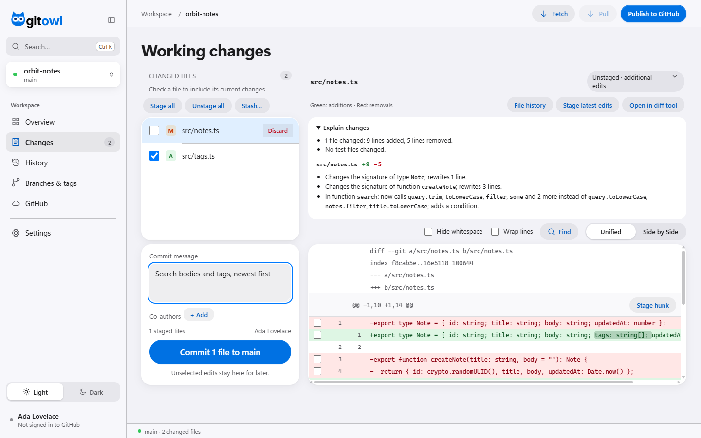
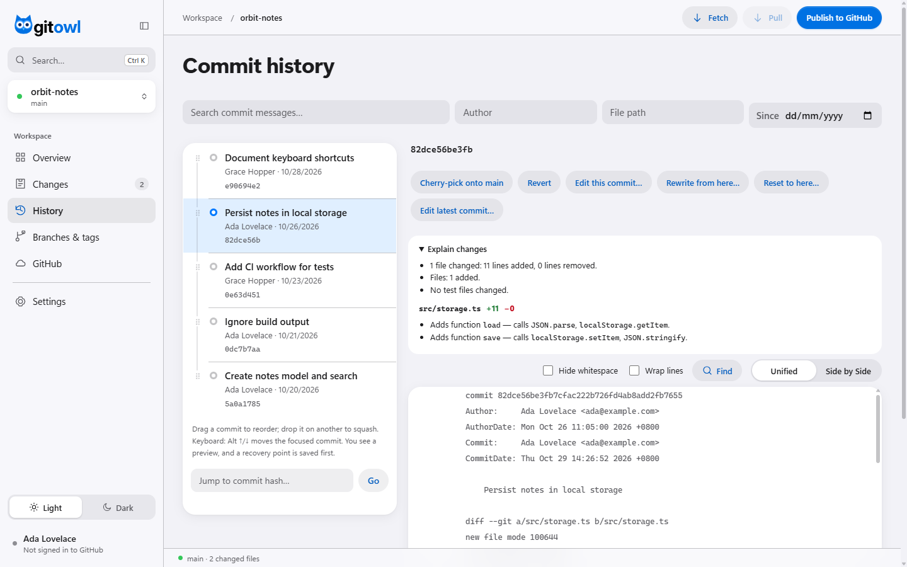
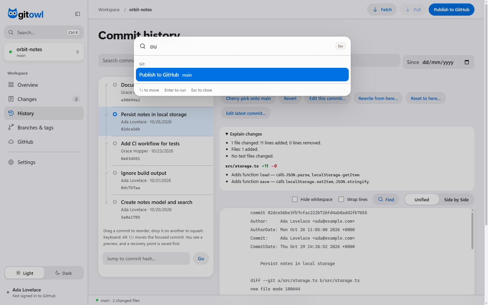
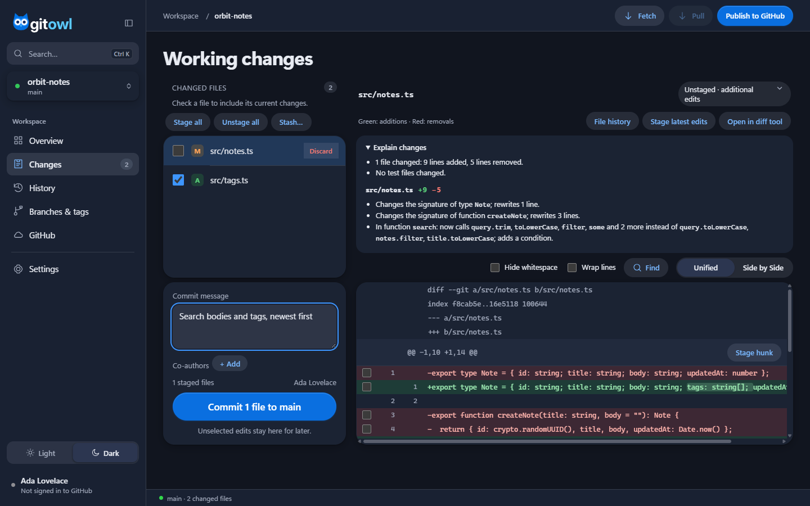
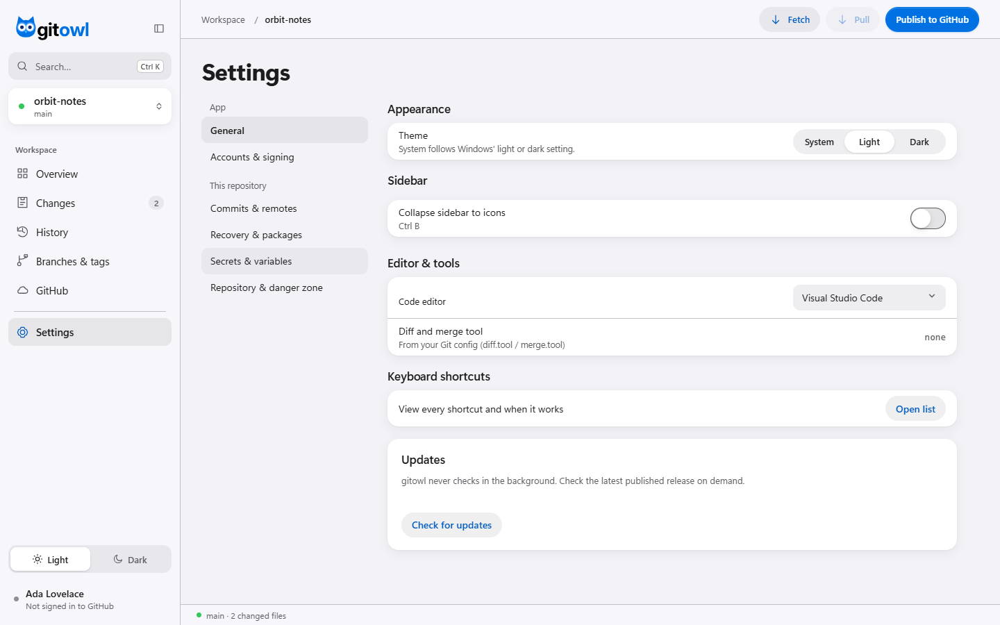

<h1 align="center">
  <picture>
    <source media="(prefers-color-scheme: dark)" srcset="assets/brand/gitowl-lockup-on-dark.svg">
    
  </picture>
</h1>

<p align="center">
  <strong>A fast, native Git and GitHub workspace — open it with one command.</strong><br>
  Stage, commit, review pull requests and fix history in a clean macOS-style window.
</p>

<p align="center">
  <a href="https://github.com/ardfaiyaz/gitowl/actions/workflows/check.yml"></a>
  <a href="#license"></a>
  <a href="https://www.rust-lang.org"></a>
  
  <a href="https://github.com/ardfaiyaz/gitowl/releases/tag/v1.0.0"></a>
</p>

<p align="center">
  <a href="#features">Features</a> ·
  <a href="#installation">Installation</a> ·
  <a href="#usage">Usage</a> ·
  <a href="#troubleshooting">Troubleshooting</a> ·
  <a href="CONTRIBUTING.md">Contributing</a> ·
  <a href="docs/ROADMAP.md">Roadmap</a>
</p>

<p align="center">
  
</p>

---

## Why gitowl?

- **One command, a real window.** Type `gitowl` in any repository and a native desktop window opens on it. No browser tab, no account, no project import.
- **Recovery built in.** Undo, history rewrites and resets save a *recovery point* first; force pushes use `--force-with-lease`; destructive actions ask before they act. Keep backups for uncommitted and untracked files.
- **GitHub without leaving the app.** Review pull requests line by line, apply suggestions, manage issues, Actions, releases, secrets and repository settings through the official GitHub CLI.
- **Local by design.** gitowl runs against your own Git and `gh` installs. Git and GitHub operations contact the remotes you select; authentication is handled by those tools.
- **One executable.** The Rust binary includes the UI. Run `node scripts/bench.mjs` to measure operations on a generated 5,000-commit repository on your machine.

## Features

<table>
<tr><td width="50%" valign="top">

**Everyday Git**
- Stage files, hunks or single lines; commit with co-authors
- Diffs with intra-line highlights, side by side, whitespace and wrap options, find, and a plain-language *Explain changes* summary
- Image diffs: side by side, swipe and onion skin
- Branches, remotes, tags, stashes, merges, pull strategies
- Three-way conflict editor, or take one side for any conflict
- Clean untracked files, Git LFS prompts, external diff tool

</td><td width="50%" valign="top">

**History you can fix**
- Searchable, filterable history and rename-aware file history
- Blame, reflog browser and recovery points
- Undo, revert, cherry-pick, reset (soft / mixed / hard)
- Edit any commit's message or author
- Reorder, squash, fixup or drop commits by drag and drop
- Verified badges for signed commits

</td></tr>
<tr><td valign="top">

**GitHub** *(via the GitHub CLI)*
- Pull requests: review threads, suggestions, Apply suggestion, checks, auto-merge, update branch, merge
- Issues: edit, pin, lock, transfer, start a linked branch
- Actions: run workflows, live logs, artifacts
- Releases, security alerts, README, organizations
- Secrets, variables, labels, rulesets and danger-zone settings
- Repository settings page with searchable sections for access, branches, Actions, environments, security, webhooks, deploy keys and Pages

</td><td valign="top">

**Built for keyboards and eyes**
- Command palette (<kbd>Ctrl</kbd> <kbd>K</kbd>) with GitHub search
- Shortcuts for commit, fetch, pages and files
- Light and dark mode, collapsible sidebar
- macOS/iOS-style design, accessible names and focus rings throughout
- Overview with review requests and your GitHub inbox
- Repository activity heatmap with daily commit counts and year selection across local and fetched branches; works offline without GitHub sign-in

</td></tr>
</table>

<details>
<summary><strong>More screenshots</strong></summary>
<br>

| History | Command palette |
|---|---|
|  |  |
| **Dark mode** | **Settings** |
|  |  |

</details>

---

## Installation

You can [download a prebuilt release](#option-1-prebuilt-release) or [build from source](#build-from-source).

### Requirements to run gitowl

| | Windows | macOS | Linux |
|---|---|---|---|
| **OS** | Windows 10 or 11, 64-bit | macOS 11 Big Sur or later | x86_64 with GTK 3 (e.g. Ubuntu 22.04+, Debian 12+, Fedora 37+) |
| **Webview** | [Microsoft Edge WebView2 Runtime](https://developer.microsoft.com/microsoft-edge/webview2/) — preinstalled on Windows 11 and updated Windows 10 | System WebKit (built in) | WebKitGTK **4.1** (`libwebkit2gtk-4.1-0`) |
| **Git** | **2.34 or newer** — [git-scm.com](https://git-scm.com/downloads) | 2.34 or newer (`brew install git` or Xcode tools) | 2.34 or newer (package manager) |
| **GitHub CLI** *(optional)* | **2.50 or newer** — only for GitHub features | 2.50 or newer | 2.50 or newer |

> gitowl is developed and tested with Git 2.45 and GitHub CLI 2.102. Local Git features work without `gh`; GitHub features throughout the app require it.

### Option 1: Prebuilt release

> **Downloads:** Get installers and archives from the [Releases page](https://github.com/ardfaiyaz/gitowl/releases), or [build from source](#build-from-source).

| Platform | Download | Notes |
|---|---|---|
| Windows | `gitowl-<version>-windows-setup.exe` (installer) or `…-x86_64-pc-windows-msvc.zip` | The installer adds `gitowl` to your PATH. |
| macOS (Apple silicon) | `gitowl-v<version>-macos.dmg` | Drag **gitowl.app** to Applications, then set up the command below. Intel Macs: build from source. |
| Linux (x86_64) | `gitowl_<version>-1_amd64.deb` or `…-x86_64-unknown-linux-gnu.tar.gz` | Built on Ubuntu 24.04. On older distributions, build from source. |

Archive names include the tag prefix, for example `gitowl-v1.0.0-x86_64-pc-windows-msvc.zip`.
Extract the archive and put its executable in a folder on your PATH. To install a Debian package,
run `sudo apt install ./gitowl_1.0.0-1_amd64.deb` from the download folder.

After moving the macOS app to Applications, make its command available in your terminal:

```sh
sudo mkdir -p /usr/local/bin
sudo ln -s /Applications/gitowl.app/Contents/MacOS/gitowl /usr/local/bin/gitowl
gitowl --version
```

Every file has a matching `.sha256` checksum. Verify a download before installing:

```sh
# macOS (download both the asset and its .sha256 file into the same folder)
shasum -a 256 -c gitowl-v1.0.0-macos.dmg.sha256
# Linux
sha256sum -c gitowl_1.0.0-1_amd64.deb.sha256
```

```powershell
# Windows: download the archive and its .sha256 file into the same folder
$asset = 'gitowl-v1.0.0-x86_64-pc-windows-msvc.zip'
$expected = (Get-Content "$asset.sha256").Split(' ')[0]
if ((Get-FileHash $asset -Algorithm SHA256).Hash -ne $expected) {
    throw 'Checksum mismatch. Download the file again before installing.'
}
```

Unsigned builds may show a SmartScreen ("Windows protected your PC" → **More info** → **Run anyway**) or Gatekeeper warning (right-click the app → **Open**).

### Build from source

#### Build requirements

| Tool | Minimum version | Tested with | Notes |
|---|---|---|---|
| [Rust](https://rustup.rs) (via rustup) | **1.88** | 1.99 | Edition 2024. The minimum is verified by compiling with 1.88. |
| [Node.js](https://nodejs.org) | **20.19+** (20.x), **22.13+** (22.x), or **24+** | 26 | Builds the UI. Use a supported LTS release. |
| npm | 10 | 11 | Ships with Node.js. |
| Git | **2.34** | 2.45 | |
| Platform toolchain | — | — | MSVC on Windows, Xcode tools on macOS, GTK/WebKitGTK headers on Linux (below). |

#### 1. Install the prerequisites

<details open>
<summary><strong>Windows 10 / 11</strong></summary>

Run in PowerShell (uses [winget](https://learn.microsoft.com/windows/package-manager/winget/), included in Windows 11):

```powershell
# C++ build tools (MSVC + Windows SDK) required by Rust on Windows
winget install --id Microsoft.VisualStudio.2022.BuildTools --exact --source winget --override "--quiet --wait --norestart --add Microsoft.VisualStudio.Workload.VCTools --includeRecommended"

winget install --id Rustlang.Rustup --exact --source winget        # Rust
winget install --id OpenJS.NodeJS.LTS --exact --source winget      # Node.js + npm
winget install --id Git.Git --exact --source winget                # Git
winget install --id GitHub.cli --exact --source winget             # optional: GitHub features

# Only if WebView2 is missing (older Windows 10):
winget install --id Microsoft.EdgeWebView2Runtime --exact --source winget
```

Open a **new** terminal so the tools are on your PATH, then confirm:

```powershell
rustc --version; cargo --version; node --version; npm --version; git --version
```

The package IDs have been verified with `winget show`. Installation on a clean Windows
machine has not been tested; the Windows source build is checked in CI.

</details>

<details>
<summary><strong>macOS</strong></summary>

```sh
xcode-select --install                     # Apple command line tools (compiler, Git)
curl --proto '=https' --tlsv1.2 -sSf https://sh.rustup.rs | sh   # Rust
. "$HOME/.cargo/env"                       # make Cargo available in this shell
brew install node git gh                   # Node.js, a newer Git, GitHub CLI (optional)
```

[Homebrew](https://brew.sh) is the easiest way to get Node.js; the [nodejs.org installer](https://nodejs.org) works too.

</details>

<details>
<summary><strong>Linux — Debian / Ubuntu</strong> (tested in CI)</summary>

```sh
sudo apt update
sudo apt install -y build-essential curl git pkg-config \
  libgtk-3-dev libwebkit2gtk-4.1-dev libxdo-dev libdbus-1-dev
curl --proto '=https' --tlsv1.2 -sSf https://sh.rustup.rs | sh   # Rust
. "$HOME/.cargo/env"
# Node.js 22 LTS or newer: https://nodejs.org/en/download (distribution packages are often too old)
# GitHub CLI (optional): https://github.com/cli/cli/blob/trunk/docs/install_linux.md
```

</details>

<details>
<summary><strong>Linux — Fedora / Arch</strong> (prerequisites tested in CI containers)</summary>

```sh
# Fedora
sudo dnf install gcc gcc-c++ curl git pkgconf-pkg-config gtk3-devel webkit2gtk4.1-devel libxdo-devel dbus-devel
# Arch
sudo pacman -Syu --needed base-devel curl git pkgconf gtk3 webkit2gtk-4.1 xdotool dbus
```

Then install Rust and activate Cargo:

```sh
curl --proto '=https' --tlsv1.2 -sSf https://sh.rustup.rs | sh
. "$HOME/.cargo/env"
```

Install a supported Node.js LTS release from [nodejs.org](https://nodejs.org/en/download)
(22.13+ on 22.x, or 24+). Package names follow the official
[Fedora](https://packages.fedoraproject.org/pkgs/webkitgtk/webkit2gtk4.1-devel/)
and [Arch](https://archlinux.org/packages/extra/x86_64/webkit2gtk-4.1/) repositories.
CI installs these packages and checks native headers and linking. Desktop window behavior
on Fedora and Arch still needs testing on those systems.

</details>

#### 2. Build and install

```sh
git clone https://github.com/ardfaiyaz/gitowl.git
cd gitowl

npm --prefix frontend ci            # install the UI's exact dependency versions
npm --prefix frontend run build     # build the UI (embedded into the executable)
cargo install --path . --locked     # build in release mode and install the `gitowl` command
```

`cargo install` puts `gitowl` in Cargo's bin folder (`~/.cargo/bin`, or `%USERPROFILE%\.cargo\bin` on Windows), which rustup adds to your PATH.

On Windows you can also run `scripts\build.ps1`, which performs the same steps and leaves the executable at `target\release\gitowl.exe`.

#### 3. Verify

```sh
gitowl --version
```

#### Updating

Pull the latest code and repeat step 2. If you installed a prebuilt release, **Settings → General → Check for updates** tells you when a newer release exists (it only checks when you click).

#### Uninstalling

```sh
cargo uninstall gitowl          # if installed from source
```

Windows installer builds uninstall from **Settings → Apps**. For a macOS app install, remove
`/Applications/gitowl.app` and the `/usr/local/bin/gitowl` symlink you created. For a Debian
package, run `sudo apt remove gitowl`. For an archive, remove the extracted files.
The recent-projects list and repository recovery points remain (see [Configuration](#configuration)).

### Set up GitHub features (optional)

gitowl uses the [GitHub CLI](https://cli.github.com) for GitHub operations. `gh` uses your
operating system's credential store when available; otherwise it can fall back to a plaintext
config file. See the [GitHub CLI authentication documentation](https://cli.github.com/manual/gh_auth_login)
and check `gh auth status` to see your authentication state.

```sh
gh auth login            # choose GitHub.com, HTTPS, and log in with a browser
```

Some features need extra token scopes, which `gh` adds on request:

| Feature | Command |
|---|---|
| SSH / GPG key lists in Settings | `gh auth refresh -s read:public_key,read:gpg_key` |
| Organization secrets and variables | `gh auth refresh -s admin:org` (also requires organization permission) |
| Security alerts | `gh auth refresh -s security_events` |
| Deleting a repository | `gh auth refresh -s delete_repo` |

---

## Usage

```sh
gitowl                       # open the repository in the current folder
gitowl path/to/repository    # open a specific repository (or any folder inside it)
gitowl --library             # start on the Open folder screen
```

Outside a repository, gitowl shows a welcome screen with **Open Folder**, **Clone from GitHub** and **New Repository**. Closing the window quits gitowl.

### Command-line options

| Option | Description |
|---|---|
| `[PATH]` | Repository, or a folder inside one. Defaults to the current directory. |
| `--library` | Show the Open folder screen instead of opening the current repository. |
| `--no-browser` | Headless mode for development and automated checks: no window, prints a local URL. |
| `--port <PORT>` | Port for the local server. `0` (the default) picks a free port. |
| `-h`, `--help` | Show help. |
| `-V`, `--version` | Show the version. |

### Keyboard shortcuts

| Action | Shortcut |
|---|---|
| Command palette | <kbd>Ctrl</kbd> <kbd>K</kbd> (<kbd>⌘</kbd> <kbd>K</kbd> on macOS) |
| Switch page | <kbd>Ctrl</kbd> <kbd>1</kbd>–<kbd>7</kbd> |
| Commit staged changes | <kbd>Ctrl</kbd> <kbd>Enter</kbd> in the message box |
| Fetch | <kbd>Ctrl</kbd> <kbd>⇧</kbd> <kbd>F</kbd> |
| Next / previous changed file | <kbd>J</kbd> / <kbd>K</kbd> |
| Toggle sidebar | <kbd>Ctrl</kbd> <kbd>B</kbd> |
| Move a commit in History | <kbd>Alt</kbd> <kbd>↑</kbd> / <kbd>↓</kbd> |

Shortcuts don't fire while you're typing in a field (except <kbd>Ctrl</kbd> <kbd>K</kbd> and <kbd>Ctrl</kbd> <kbd>Enter</kbd>). The full list is in **Settings → General**.
Use <kbd>⌘</kbd> in place of <kbd>Ctrl</kbd> on macOS.

### Configuration

gitowl keeps almost no state of its own:

| What | Where |
|---|---|
| Recent projects | `%LOCALAPPDATA%\gitowl\recent.json` (Windows), `$XDG_CONFIG_HOME/gitowl/recent.json` or `~/.config/gitowl/recent.json` |
| WebView2 browser data (Windows) | `%LOCALAPPDATA%\gitowl\WebView2` |
| Theme, sidebar, editor choice | The app window's local storage; the native window uses an incognito session, so these preferences may reset when it closes |
| Commit identity, signing, diff tool | Your normal Git config (`git config`) — gitowl reads and writes it there |
| Recovery points | `refs/gitowl/recovery/*` inside each repository; manage them in **Settings → Recovery & packages** |
| GitHub sign-in | The GitHub CLI's own config and credential store |

---

## Troubleshooting

<details>
<summary><strong>Windows v0.1.0: WebView2 error 0x80070005 ("Access is denied")</strong></summary>

The v0.1.0 installer puts the executable in Program Files, but that build tries to create
WebView2's data folder beside it. Use a writable folder for the current PowerShell session:

```powershell
$env:WEBVIEW2_USER_DATA_FOLDER = "$env:LOCALAPPDATA\gitowl\WebView2"
gitowl
```

Upgrade to v0.1.1 or later to use this location automatically. Administrator rights are not required to run gitowl.
</details>

<details>
<summary><strong>The window is blank, or shows an old interface</strong></summary>

The UI is embedded at build time. Run `npm --prefix frontend run build`, then rebuild (`cargo run` or `cargo install --path . --locked`).
</details>

<details>
<summary><strong>Windows: "WebView2 Runtime is missing" or the window doesn't open</strong></summary>

Install the runtime: `winget install --id Microsoft.EdgeWebView2Runtime --exact --source winget`, or download the Evergreen installer from [Microsoft](https://developer.microsoft.com/microsoft-edge/webview2/).
</details>

<details>
<summary><strong>Windows: <code>link.exe</code> not found / MSVC errors while building</strong></summary>

Install the Visual Studio Build Tools with the **Desktop development with C++** workload (command in [step 1](#1-install-the-prerequisites)), then open a new terminal.
</details>

<details>
<summary><strong>Linux: <code>webkit2gtk-4.1</code> or <code>gtk+-3.0</code> not found while building</strong></summary>

Install the development packages for your distribution from [step 1](#1-install-the-prerequisites). WebKitGTK must be version **4.1**; the older `libwebkit2gtk-4.0` does not work.
</details>

<details>
<summary><strong><code>gitowl</code>: command not found</strong></summary>

Add Cargo's bin folder to your PATH (`~/.cargo/bin` or `%USERPROFILE%\.cargo\bin`) and open a new terminal.
</details>

<details>
<summary><strong>The GitHub page asks me to sign in</strong></summary>

Run `gh auth login` in a terminal, then click **Check again**. Run `gh auth status` to see which account `gh` uses.
</details>

<details>
<summary><strong>A push or pull waits and then fails</strong></summary>

gitowl can't answer interactive password prompts. Make sure Git can authenticate on its own (a credential helper or SSH key), for example by running `git fetch` once in a terminal. Git commands time out after 120 seconds.
</details>

Still stuck? [Open an issue](https://github.com/ardfaiyaz/gitowl/issues/new/choose) with your OS, `gitowl --version` and `git --version`.

---

## How it works

gitowl is a Rust program ([axum](https://github.com/tokio-rs/axum) server + [tao](https://github.com/tauri-apps/tao)/[wry](https://github.com/tauri-apps/wry) window) with a React + TypeScript interface built by Vite and embedded into the executable.
The window talks to a server bound to `127.0.0.1` with a random per-session token. Every action runs the real `git` or `gh` executable with separate arguments (never through a shell), so gitowl behaves exactly like Git does in your terminal — hooks, signing and credential helpers included.
See [SECURITY.md](SECURITY.md) for the full security model and [docs/PRD.md](docs/PRD.md) for the product requirements.

## Contributing

Contributions are welcome — bug reports, ideas, documentation and code. Start with [CONTRIBUTING.md](CONTRIBUTING.md) for the development setup, project layout, checks and design rules, and please follow the [Code of Conduct](CODE_OF_CONDUCT.md).

Quick start for developers:

```sh
npm --prefix frontend ci && npm --prefix frontend run build
cargo run
```

## Roadmap

See [docs/ROADMAP.md](docs/ROADMAP.md) for what's done and what's next, and [CHANGELOG.md](CHANGELOG.md) for release notes.

## License

gitowl is dual-licensed under either of

- [MIT License](LICENSE-MIT)
- [Apache License, Version 2.0](LICENSE-APACHE)

at your option. Unless you explicitly state otherwise, any contribution intentionally submitted for inclusion in gitowl shall be dual-licensed as above, without any additional terms or conditions.

## Acknowledgements

- The gitowl wordmark is drawn from **Inter Display Bold** by Rasmus Andersson, under the [SIL Open Font License](assets/brand/Inter-OFL.txt).
- Built on [Git](https://git-scm.com), the [GitHub CLI](https://cli.github.com), [Rust](https://www.rust-lang.org), [tao](https://github.com/tauri-apps/tao), [wry](https://github.com/tauri-apps/wry), [axum](https://github.com/tokio-rs/axum), [React](https://react.dev) and [Vite](https://vite.dev).
